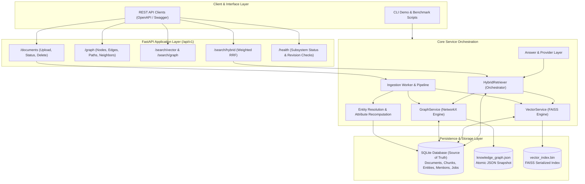

# GraphRAG Knowledge System

> A production-grade, modular, local-first Graph-Augmented Retrieval & Generation service combining semantic vector search (FAISS) and structured knowledge graph traversal (NetworkX) with SQLite as the relational source of truth.

---

## 📌 Project Overview

**GraphRAG Knowledge System** is an enterprise-ready knowledge engine designed to extract, index, link, and retrieve interconnected knowledge from unstructured documents. Rather than relying solely on flat vector embeddings—which can lose multi-hop relational context—or rigid relational databases alone, this system bridges both paradigms through a unified **Hybrid Retrieval Engine** powered by **Reciprocal Rank Fusion (RRF)**.

Built with a CPU-first, local-first architecture, the system guarantees determinism, zero cloud API lock-in, atomic persistence, and verifiable provenance tracking from answer citations down to the original document chunk.

---

## 🔍 Problem Statement

Traditional Retrieval-Augmented Generation (RAG) relies almost entirely on semantic vector similarity. While effective for simple topical queries, traditional vector RAG faces significant limitations:
- **Relational Blindness:** Fails to follow structured multi-hop connections between entities (e.g., *“Who works at the organization founded by person X?”*).
- **Hallucination & Provenance Loss:** Generative models often fabricate facts when context is fragmented across separate document chunks.
- **Silent Failures:** In typical RAG systems, model downtime or index corruption fails silently or returns ungrounded speculation.
- **Privacy & Infrastructure Overkill:** Many systems force remote API dependencies (e.g., third-party vector databases, paid embedding and LLM APIs), violating data sovereignty.

**GraphRAG Knowledge System** solves this by establishing a verifiable pipeline:
1. **Relational Source of Truth:** Documents, chunks, entities, relationships, jobs, and query history live in SQLite with strict foreign keys and Alembic migrations.
2. **Dual-Index Synchronization:** Vector embeddings (FAISS) and knowledge graphs (NetworkX) are treated as derived, rebuildable artifacts synchronized with relational revisions.
3. **Multi-Strategy Hybrid Retrieval:** Combines dense semantic similarity with multi-hop graph neighbor traversal via weighted Reciprocal Rank Fusion.
4. **Verifiable Generation:** Provider abstraction (extractive baseline, local Ollama, OpenAI-compatible, scripted mock) enforcing loopback-only safety and heuristic lexical grounding.

---

## 🚀 Key Features

### 1. Robust Multi-Format Document Ingestion
- Ingests **PDF** (`PyMuPDF`), **DOCX** (`python-docx`), **Markdown**, and **Plain Text** files.
- Asynchronous thread-pool processing with persistent job tracking (`pending` → `extracting` → `chunking` → `persisting` → `extracting_knowledge` → `completed`).
- Structural validation: Magic byte sniffing, ZIP bomb protection, SHA-256 deduplication, and size guardrails.
- Deterministic chunking scoped to document segments (PDF pages, DOCX sections) preventing cross-boundary noise.

### 2. Knowledge Graph Extraction & Entity Resolution
- Provider-agnostic extraction layer with built-in rule-based heuristics and schema-validated entity/relationship extractors.
- Evidence-backed entity normalization: Case-insensitive compact keys, suffix stripping (e.g., `Inc`, `Corp`, `Ltd`), and fuzzy matching candidate detection.
- **Evidence-Derived Entity Attributes:** Canonical names and descriptions are dynamically recomputed from earliest supporting evidence upon document deletion or reprocessing.

### 3. High-Performance Knowledge Graph (NetworkX)
- In-memory `MultiDiGraph` preserving direction, multi-relationship types between entities, and aggregate evidence.
- Multi-hop traversal: Configurable bounded Breadth-First Search (BFS), shortest paths (directed & undirected with reverse-edge provenance tracking), and centrality metrics.
- Atomic persistence to disk (`knowledge_graph.json`) using self-healing revision tracking against SQLite.

### 4. Semantic Vector Indexing (FAISS)
- Exact L2-normalized inner product indexing (`IndexFlatIP`) using `sentence-transformers/all-MiniLM-L6-v2` (pinned revision for strict reproducibility).
- **Windowed Mean Pooling (`window-mean-v1`):** Chunks exceeding the embedding model's sequence length are windowed and pooled without lossy truncation.
- Thread-safe snapshot isolation (`IndexSnapshot`) allowing concurrent searches during background index synchronization.

### 5. Hybrid Retrieval Engine (RRF)
- Direct in-memory fusion of dense vector candidates and graph traversal candidates using weighted **Reciprocal Rank Fusion** ($RRF = \sum \frac{w}{k + rank}$).
- Resilient multi-path status reporting: Graceful degradation to single-path mode (`partial`) with explicit warning headers if one subsystem fails.
- Entity linking from query text with token boundary enforcement.

### 6. Grounded Answer Generation & Replaceable Provider Layer
- Pluggable provider protocol (`LLMProvider`) supporting:
  - **Extractive Provider (Default):** Deterministic, zero-dependency baseline extracting scored sentences verbatim with citation tags `[S1]`, `[S2]`.
  - **Ollama Provider:** Native integration with local Ollama instances (`/api/chat`).
  - **OpenAI-Compatible Provider:** Local or self-hosted engines (vLLM, llama.cpp, LM Studio).
  - **Mock Provider:** Scripted test double for CI/CD.
- Strict data privacy: Local loopback verification enforcing that document data never leaves the host without explicit configuration (`GRAPHRAG_LLM_ALLOW_REMOTE=true`).

---

## 🏗️ System Architecture



---

## 🛠️ Technology Stack

| Layer | Technologies | Purpose |
|---|---|---|
| **Language & Runtime** | Python 3.12+ | High-performance modern Python with type annotations |
| **API Framework** | FastAPI, Uvicorn, Pydantic v2 | High-throughput async REST endpoints & schema validation |
| **Relational Storage** | SQLite, SQLAlchemy 2.0, Alembic | ACID source of truth, migrations, deterministic identity |
| **Graph Processing** | NetworkX | In-memory multigraph queries, pathfinding, graph analytics |
| **Vector Search** | FAISS (`faiss-cpu`), NumPy | Dense inner-product cosine similarity search |
| **Embeddings** | `sentence-transformers` | CPU-optimized `all-MiniLM-L6-v2` dense vectors |
| **Document Parsers** | PyMuPDF (`pymupdf`), `python-docx` | Native PDF, DOCX, Markdown, and TXT parsing |
| **Networking & HTTP** | HTTPX | Connection-pooled HTTP client with mock transport testing |
| **Testing & Quality** | Pytest, Pytest-Cov, Ruff | Comprehensive automated testing suite (>1400 tests) & linting |

---

## 📂 Project Structure

```
GraphRAG-Knowledge-System/
├── .env.example              # Fully documented environment variable reference
├── .gitignore                # Multi-stage ignore rules for Python, DBs, models, logs
├── README.md                 # Complete project documentation
├── requirements.txt          # Root dependency entrypoint
├── backend/
│   ├── alembic.ini           # Database migration configuration
│   ├── pyproject.toml        # Ruff linter and pytest settings
│   ├── requirements.txt      # Production dependencies
│   ├── requirements-dev.txt  # Testing and development dependencies
│   ├── app/
│   │   ├── main.py           # FastAPI application entrypoint & lifespan management
│   │   ├── api/              # REST route controllers (documents, graph, search, hybrid)
│   │   ├── core/             # Configuration, logging, database engines, privacy controls
│   │   ├── models/           # SQLAlchemy ORM database models
│   │   ├── schemas/          # Pydantic v2 validation and transfer schemas
│   │   ├── services/
│   │   │   ├── ingestion/    # Parsers, chunkers, normalization, ingestion worker
│   │   │   ├── extraction/   # Entity/relation extractors, rule-based matching, resolution
│   │   │   ├── graph/        # NetworkX graph builder, persistence, analytics, queries
│   │   │   ├── embeddings/   # SentenceTransformers embedding, windowing, FAISS index
│   │   │   ├── retrieval/    # Vector search, graph search, entity linker, RRF fusion
│   │   │   └── generation/   # Provider protocol, token estimation, Mock/Ollama/OpenAI
│   │   └── workers/          # Ingestion background worker pool
│   ├── migrations/           # Alembic revision scripts (0001 through 0006)
│   └── tests/
│       ├── conftest.py       # Shared fixtures and test isolation setup
│       ├── unit/             # Isolated unit tests for all components
│       ├── integration/      # End-to-end multi-service integration tests
│       └── slow/             # Opt-in real embedding model validation tests
├── data/                     # Local data root (SQLite DB, graph JSON, FAISS index)
├── docs/                     # Architectural specifications and phase reports
├── evaluation/               # Benchmark reports and evaluation datasets
└── scripts/                  # Standalone verification, demo, and benchmarking tools
    ├── samples/              # Sample documents for validation
    ├── extract_demo.py       # CLI demonstration of knowledge extraction
    ├── graph_demo.py         # CLI demonstration of NetworkX graph queries
    ├── vector_demo.py        # CLI demonstration of vector search & windowing
    ├── hybrid_demo.py        # CLI demonstration of hybrid vector + graph RRF retrieval
    └── hybrid_benchmark.py   # Latency and throughput benchmarks
```

---

## ⚙️ Installation & Setup

### Prerequisites
- **Python:** 3.12 or higher
- **Git:** 2.40 or higher
- **OS:** Windows, Linux, or macOS

### 1. Clone the Repository
```bash
git clone https://github.com/harishhh-paaatel/GraphRAG-Knowledge-System.git
cd GraphRAG-Knowledge-System
```

### 2. Set Up Virtual Environment
```bash
# Create virtual environment
python -m venv backend/.venv

# Activate virtual environment
# Windows (PowerShell):
backend\.venv\Scripts\Activate.ps1
# Linux / macOS:
source backend/.venv/bin/activate
```

### 3. Install Dependencies
```bash
cd backend
pip install --upgrade pip
pip install -r requirements-dev.txt
```

### 4. Configure Environment
Copy the sample environment file and configure variables:
```bash
# Return to repository root
cd ..
cp .env.example .env
```
*Note: The defaults in `.env.example` work out-of-the-box for a local CPU setup without requiring external services.*

### 5. Initialize the Database
Run Alembic migrations to set up the SQLite schema:
```bash
cd backend
python -m alembic upgrade head
```

---

## 🚦 Usage & Workflow

### 1. Run the REST API Server
```bash
cd backend
python -m uvicorn app.main:app --host 127.0.0.1 --port 8000 --reload
```
Access the interactive OpenAPI Swagger documentation at:  
👉 **`http://127.0.0.1:8000/docs`**

---

### 2. Walkthrough: From Document to Hybrid Search

#### Step A: Upload a Document
Upload a Markdown, PDF, or text file:
```bash
curl -X POST "http://127.0.0.1:8000/api/v1/documents/upload" \
     -H "Content-Type: multipart/form-data" \
     -F "file=@scripts/samples/backend_stack.md"
```
*Returns `202 Accepted` with a `document_id` and job status.*

#### Step B: Check Document Processing Status
```bash
curl -X GET "http://127.0.0.1:8000/api/v1/documents/{document_id}/status"
```

#### Step C: Inspect Knowledge Graph Nodes and Paths
Explore nodes created during extraction:
```bash
curl -X GET "http://127.0.0.1:8000/api/v1/graph/overview"
```

Find paths between entities:
```bash
curl -X GET "http://127.0.0.1:8000/api/v1/graph/path?source={source_entity_id}&target={target_entity_id}"
```

#### Step D: Perform Hybrid Search
Query using fused dense vector and structured knowledge graph traversal:
```bash
curl -X POST "http://127.0.0.1:8000/api/v1/search/hybrid" \
     -H "Content-Type: application/json" \
     -d '{
       "query": "Who works at Acme Inc and what technologies do they use?",
       "limit": 5,
       "explain": true
     }'
```

---

### 3. Standalone CLI Demonstrations

Run standalone self-contained demonstrations directly from the terminal:

```bash
# 1. Knowledge Extraction Demo
backend\.venv\Scripts\python scripts/extract_demo.py scripts/samples/backend_stack.md scripts/samples/team_notes.txt

# 2. Knowledge Graph Traversal Demo
backend\.venv\Scripts\python scripts/graph_demo.py

# 3. Vector Search & Windowing Demo
backend\.venv\Scripts\python scripts/vector_demo.py

# 4. Hybrid Retrieval (Vector + Graph RRF) Demo
backend\.venv\Scripts\python scripts/hybrid_demo.py
```

---

## 🧪 Testing & Verification

The codebase maintains rigorous quality gates with over **1,400 automated tests** covering unit behavior, database schema transitions, adversarial inputs, and multi-service concurrency.

```bash
cd backend

# Run the complete automated test suite
python -m pytest

# Run with test coverage report
python -m pytest --cov=app --cov-report=term-missing

# Run code style and linting checks
python -m ruff check . ../scripts

# Check code formatting
python -m ruff format --check . ../scripts
```

---

## 🗺️ Roadmap & Future Enhancements

- [x] **Phase 1–2:** Backend Foundation & Ingestion Engine (Multi-format parsers, chunking, jobs)
- [x] **Phase 3–4:** Knowledge Extraction & NetworkX Knowledge Graph (Entity linking, traversal, atomic sync)
- [x] **Phase 5–6:** Vector Search (FAISS) & Hybrid Retrieval (Reciprocal Rank Fusion, timeouts, hardening)
- [x] **Phase 7 (M0–M1):** Answer Generation Foundations & Provider Abstractions (Extractive, Ollama, OpenAI)
- [ ] **Phase 7 (M2–M6):** Citation Verification, Context Budgeting, Hallucination Guards, and Query History API
- [ ] **Phase 8:** Comprehensive Evaluation Framework (Faithfulness, Precision@K, Recall@K, MRR)
- [ ] **Phase 9:** Modern Web UI (Interactive Cytoscape.js Graph Visualizer, Query Explorer, Document Manager)
- [ ] **Phase 10:** Production Containerization (Docker, Docker Compose, automated CI/CD pipelines)

---

## 🔒 Security & Data Privacy

- **Zero Cloud Leakage by Default:** Out-of-the-box configuration restricts all network calls to local loopback (`127.0.0.1`).
- **Secret Sanitization:** All internal exceptions, logs, and error responses pass through a privacy scrubber to prevent accidental API key leaks.
- **Strict Input Validation:** Uploaded files undergo MIME verification and byte-level sniffing to protect against parser exploits and decompression bombs.

---

## 📄 License

This project is licensed under the MIT License - see the [LICENSE](LICENSE) file for details.
