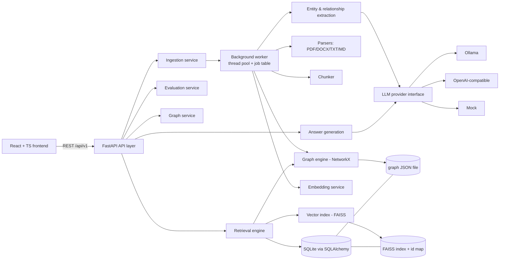
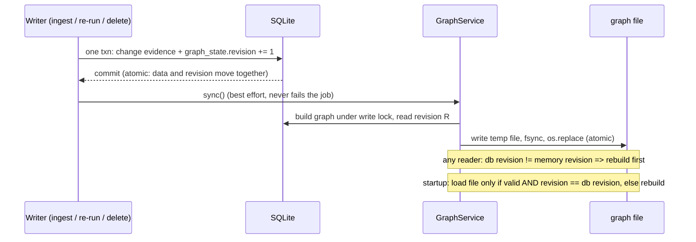
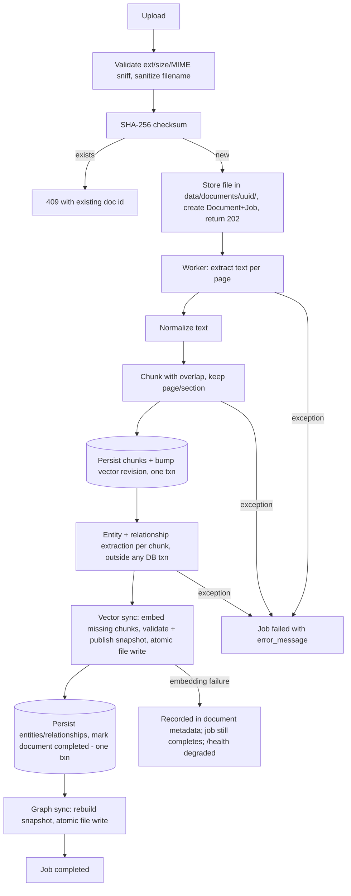

# GraphRAG Knowledge Service — Architecture

Status: **Phases 0-6 are implemented** (ingestion, extraction, knowledge graph, vector retrieval, graph and hybrid retrieval; Phase 6 is awaiting final approval). Answer generation, evaluation, frontend and DevOps (Phases 7-11) are still design only and are marked as such. Per-phase results, test counts and known limitations are in `docs/implementation-plan.md`; the closing reports are `docs/phase-5-final-report.md` and `docs/phase-6-final-report.md`.

## 1. Environment findings (measured on the dev machine, Phase 0 snapshot)

_Taken before any code existed (e.g. the workspace was empty then); kept as the record of the constraints the design was based on._

| Item | Finding | Implication |
|---|---|---|
| Workspace | `E:\GraphRAG Knowledge System` — empty, not a git repo | Clean start; `git init` happens in Phase 1 (local only, no push) |
| Python | 3.12.0 (only interpreter; `python3` is a Store stub) | Meets 3.11+; use a venv |
| Node / npm | 22.20.0 / 10.9.3 | Fine for Vite/React; use npm (no pnpm) |
| Git | 2.51.0 | OK |
| Docker | 29.4.1, Compose v5.1.3 | Installed. Daemon state **not verified** yet |
| Ollama | not installed | Optional; local LLM is an opt-in download |
| CPU / RAM | Ryzen 7 7435HS, 8C/16T, 23.7 GB | Ample for CPU embeddings and small quantized LLMs |
| GPU | **NVIDIA RTX 3050 Laptop, 4 GB** (brief said AMD) | Still design CPU-first; Ollama may use the GPU for ≤3B models, but nothing depends on it |
| Disk | **C: 5.4 GB free**, D: 103 GB, E: 131 GB | Keep venv, `HF_HOME`, Ollama models and Docker data on E:. Torch + models on C: would risk filling it |

## 2. Architecture

Modular monolith, layered: API → services → repositories/providers → storage. One deployable backend, one frontend. No microservices (unjustified at this scale).



### Source-of-truth and synchronization
- **SQLite is the source of truth** for documents, chunks, entities, relationships, jobs, history.
- **The graph file and the FAISS index are derived, rebuildable artifacts.** Each stores only IDs that reference SQL rows (the graph additionally embeds its evidence so it can be queried without SQL).
- Ingestion order per document: (1) write SQL rows in one transaction, (2) update in-memory graph + vectors, (3) persist derived files atomically (write temp file, `os.replace`), (4) mark job `completed`. A crash before (4) leaves the job `failed/incomplete`; retry is idempotent because chunk IDs are deterministic (`sha1(doc_checksum:chunk_index)`) and entity/relationship writes are upserts.
- Deletion: SQL transaction deletes document → cascades chunks/relationships; entities left with no remaining evidence are removed; then graph nodes/edges and FAISS vectors are removed and files re-persisted. Rebuilding from SQL is the recovery path for any drift: implemented for the graph in Phase 4 (`GraphService.rebuild()`, automatic at startup and on first read after any change); the vector index in Phase 5 (`VectorService.sync()` / `rebuild()`, automatic at startup and before serving a query; see "Vector embeddings and retrieval" below).
- Startup consistency check compares counts of SQL chunks vs. index vectors and graph edges vs. relationship rows, and logs/exposes mismatches in `/health`.

### Derived entity attributes
An entity's `canonical_name`, `description` and aliases are never stored independently of evidence: they are recomputed from the remaining `entity_mentions` (earliest evidence wins) whenever evidence changes, with sources recorded in `entities.metadata`. Identity (`id`, `normalized_key`, `entity_type`) is immutable. Details in implementation-plan.md, Phase 3.1.

## Knowledge graph (Phase 4)

NetworkX is a **derived, rebuildable view** of SQLite; SQLite stays the single source of truth.

### Model
`networkx.MultiDiGraph`. A *node* is an entity that has at least one mention (node ID = the deterministic entity ID). An *edge* is one `(source, relationship_type, target)`, keyed by its relationship type, aggregating **every** relationship row that states it, so evidence from many documents/chunks is never lost. MultiDiGraph rather than DiGraph because one entity pair can legitimately carry several relationship types (`WORKS_AT` and `RELATED_TO`). Direction is exactly the stored direction; it is never reversed.

| | Attributes |
|---|---|
| Node | `entity_id`, `canonical_name`, `entity_type`, `description`, `aliases`, `mention_count`, `source_document_ids`, `normalized_key` |
| Edge | `edge_id` (= sha1 of source:type:target), `relationship_type`, `source_entity_id`, `target_entity_id`, `supporting_evidence` (list of `{relationship_id, supporting_text, document_id, chunk_id, provenance, confidence}`), `source_document_ids`, `source_chunk_ids`, `provenance`, `confidence` (`null` unless an extractor reported one) |

Relationship row IDs are deterministic (sha1 of source:type:target:chunk), so evidence identity survives reprocessing. Entities without mentions and relationships with a missing endpoint are skipped, never materialized.

### Keeping SQLite and the graph file consistent (no shared transaction)

- `graph_state.revision` is bumped inside `purge_document_knowledge`, which every path that changes graph-relevant evidence (ingest, re-run, delete) goes through, so the bump commits or rolls back with the data.
- A crash between "SQLite committed" and "graph updated" is therefore *detectable* (revision mismatch) and repaired by rebuilding; it cannot be silent.
- A failed file write keeps the new graph in memory, leaves the previous file untouched (atomic replace), reports `degraded` in `/health`, and is retried on the next sync.
- A missing, truncated, tampered or wrong-format file is moved aside to `knowledge_graph.json.corrupt` (one copy, kept for inspection) and rebuilt from SQLite.
- Readers use immutable (frozen) snapshots swapped atomically, so a query never sees a half-built graph.

### File format (`data/graphs/knowledge_graph.json`, version 1)
JSON envelope `{format, format_version, revision, built_at, node_count, edge_count, sha256, graph}` where `graph` is NetworkX node-link data (directed, multigraph) and `sha256` covers its canonical JSON. JSON node-link instead of GraphML because edges carry nested evidence lists that GraphML can only store as opaque strings; the checksum and counts make truncation and bit-rot detectable.

### Queries and limits
Direct neighbors (out / in / both), bounded multi-hop BFS (deterministic, closest nodes kept on truncation, reports which limit was hit), directed or undirected shortest path (reverse steps are labelled and keep their stored direction), subgraph extraction (walked edges, or `induced` = all edges among returned nodes) and entity lookup (exact > prefix > substring over names and aliases). Default direction is `out`; both-directions exploration is opt-in. Hard caps (`GRAPHRAG_GRAPH_MAX_HOPS/NODES/EDGES`, defaults 4/500/1000) are enforced on every request.

### Analytics
Node/edge counts, entity- and relationship-type distributions, in/out degree, degree centrality, density, **weakly and strongly connected components** (reported separately). Computed on demand and cached per graph revision. Counting convention: an edge is one aggregated source-type-target, so degrees are multigraph degrees and `degree_centrality = degree / (n-1)` can exceed 1.

### Endpoints
`GET /api/v1/graph/overview`, `/nodes`, `/edges`, `/entities/{id}`, `/entities/{id}/neighbors`, `/path`; every response that contains relationships carries `supporting_evidence`, source document/chunk IDs, and a `documents` map (id -> filename). Details and examples are in `docs/implementation-plan.md` (Phase 4 notes).

## Vector embeddings and retrieval (Phase 5)

Semantic retrieval is exact cosine search over chunk embeddings. As with the graph, **SQLite is the
source of truth** (`document_chunks` decides what must be indexed); the vector index is a derived,
rebuildable artifact, reconciled against SQLite and never trusted over it.

### Components
| Module (`backend/app/services/...`) | Role |
|---|---|
| `embeddings/embedder.py` | `Embedder` interface; `SentenceTransformerEmbedder` (real model, lazy, loaded once); `HashingEmbedder` (deterministic lexical stub used by the default test suite, never selected by default) |
| `embeddings/windowing.py` | token-limit policy `window-mean-v1` (below) |
| `embeddings/vector_index.py` | `VectorIndex` / `IndexEngine` protocols, `FaissFlatIPIndex`, `FAISS_ENGINE` |
| `embeddings/vector_store.py` | single-file index format, atomic write, full validation on load |
| `embeddings/snapshot.py` | `IndexSnapshot`: immutable index + metadata, with validation |
| `embeddings/service.py` | `VectorService`: sync, rebuild, recovery, last-known-good reads |
| `embeddings/revision.py` | `vector_state.revision` counter helpers |
| `retrieval/vector_search.py` | query pipeline and the similarity policy |
| `api/search.py`, `api/vector.py` | `POST /search/vector`, `GET /vector/index`, `POST /vector/rebuild` |

### Model, dimensions, normalization
- Default model `sentence-transformers/all-MiniLM-L6-v2`, **pinned to Hugging Face commit
  `1110a243fdf4706b3f48f1d95db1a4f5529b4d41`**: 384 dimensions, input limit 256 tokens (special tokens
  included), CPU. The pin applies only to the default model; any other model is unpinned unless a
  40-character commit hash is configured (anything else is rejected). A pinned commit is *verified*
  after loading: if the cached snapshot is a different commit, loading fails instead of silently using it.
- Every embedder returns L2-normalized float32 vectors, so FAISS inner product equals cosine similarity.
  Blank or non-string input is rejected; nothing is embedded "as empty".
- **Fingerprint** (decides whether an existing index may be used): embedder kind, model name, requested
  revision, `max_seq_length` override, normalization, oversize policy id. After the model loads, the
  resolved revision, dimension and token limit are compared with the index metadata too. Batch size,
  device and offline mode do not change vector values and are deliberately *not* part of it.
  A mismatch discards the whole index and rebuilds it from SQLite; vectors from different
  configurations are never mixed.

### Token limit and truncation policy (`window-mean-v1`)
Models read a fixed number of tokens and silently ignore the rest. Measured on the real model: the vector
of a 1,158-token text had cosine 1.0000 with the vector of its first 256 tokens (the tail contributed
nothing), and the same 800 characters were 143 tokens as prose but 361-489 tokens as URLs, digits or
code. So detection uses the model's **own tokenizer**, never character counts.
1. A chunk of at most `max_tokens` tokens is embedded as is.
2. Otherwise it is split, losslessly and without overlap, into windows of at most `max_tokens` tokens:
   at sentence ends first, then between words, and only for a single over-long "word" at the largest
   character prefix that fits. Splitting is deterministic.
3. Each window is embedded; the chunk's vector is the token-weighted mean of the window vectors,
   re-normalized. One chunk still maps to exactly one vector, so chunk IDs, filtering and provenance
   (document, page, section) are unchanged. The chunk text in SQLite is never modified.
4. Nothing is silent: `token_count` and `windows` are stored per chunk (index entry and
   `chunk_embeddings`), the document metadata reports `chunks_over_token_limit_pooled`, and
   `GET /vector/index` reports `oversized_chunks_pooled`. Search queries are handled identically and the
   response reports `query_token_count` / `query_windows`.
A model with no usable tokenizer or limit is refused outright rather than truncating silently.
_Limitation:_ mean pooling is a heuristic that blurs very long chunks; its effect on retrieval quality has
not been formally evaluated (Phase 8).

### FAISS index design
- `IndexFlatIP`: exact search, no approximation to confound evaluation; cost is linear in the number of
  vectors (measured numbers in the final report).
- FAISS **positions are never identities**: removing vectors shifts every later position. Identity is the
  chunk ID in a parallel ID table `(chunk_id, document_id, content_hash, token_count, windows)`.
- Results are ordered by score descending, ties by chunk ID; a tie that straddles the top-K cut-off widens
  the search until the whole tie group is seen, so the outcome never depends on FAISS internals.
  Document filters use a FAISS id selector, so top-K is taken *within* the allowed documents.
- The protocols `VectorIndex` (one index) and `IndexEngine` (create / deserialize, with a `name` written
  into the file) are the boundary the code really uses: nothing above `vector_index.py` imports FAISS
  (a test enforces this). FAISS is the **only** engine; no second implementation exists and none is
  claimed.

### Persistence and recovery
- One file, `data/embeddings/vector_index.bin` (format v2): magic, JSON header (engine, SQLite revision,
  model, revision, dimension, `max_tokens`, fingerprint, the ID table, SHA-256 of table and payload), then
  the serialized FAISS index. One `os.replace` swaps vectors and ID table together; a failed write keeps
  the previous file and is retried on the next sync.
- Startup adopts the file only if it validates *and* its snapshot is self-consistent *and* it matches the
  current embedding fingerprint; otherwise it is moved to `vector_index.bin.corrupt` (one copy, kept for
  inspection) and rebuilt from SQLite. A file that is merely behind SQLite is brought up to date
  incrementally (only missing chunks are embedded). Deleting a document needs no model.
- `vector_state.revision` is bumped in the same transaction as any chunk change (chunk replacement during
  ingestion, document deletion); the file records the revision it was synced to.
- `chunk_embeddings` (chunk, document, content hash, model, revision, dimension, fingerprint, token and
  window counts, status `indexed|failed|stale`, timestamps) is a **report** of what the index holds.
  Vectors are not stored in SQLite.
- Embedding failures never damage the existing index: a failing chunk is isolated and recorded `failed`
  while others are indexed; a backend-wide failure aborts the sync and leaves snapshot and file untouched.
  A vector-indexing failure does not fail the document; it is recorded in `documents.metadata` and
  `/health` reports `degraded`.

### Snapshot consistency and concurrent search
A reader takes **one** immutable `IndexSnapshot` and uses it for the whole query, so the index, its ID
table and its metadata always belong to the same revision. `sync()` builds the next snapshot privately
(copy-on-write), validates that it contains exactly the chunks it was built for, and publishes it with a
single attribute assignment. A snapshot that fails validation is never published.

| Situation when a search arrives | Behaviour |
|---|---|
| snapshot current and compatible | serve it |
| behind SQLite, no sync running | this request runs the sync, then serves the new snapshot |
| behind SQLite, a sync is running, snapshot compatible | serve the **previous** snapshot, `index_stale: true` |
| snapshot incompatible with the current embedder (model/config changed), a sync is running | **503 `vector_index_building`** (vectors from another model are never served) |
| no snapshot yet, a first build is running | 503 `vector_index_building` |
| no snapshot yet, nothing running | this request builds the index |
| database or embedding failure | 503 `vector_index_unavailable` |

If chunks change while a sync is embedding, the finished vectors whose text is still current are kept and
the snapshot is recorded at the *older* revision, so the next sync reconciles the rest.

### Search API
`POST /api/v1/search/vector` - body `{"query", "top_k" (default 5, max `vector_max_top_k`=50),
"similarity_threshold" (-1..1, inclusive, optional), "document_ids" (optional, <=100)}`. Each result has
`rank, chunk_id, document_id, content, similarity, source {filename, page_number, section, chunk_index},
embedding_model`; the response adds `embedding_model_revision`, `index_revision`, `database_revision`,
`index_stale`, `indexed_vectors`, `max_tokens`, `query_token_count`, `query_windows`,
`unknown_document_ids`, `timings_ms` and `similarity_metric`.
- **`similarity` is the cosine between query and chunk embeddings: retrieval similarity, not answer
  confidence.** It is rounded to 6 decimals and `similarity_threshold` is applied to that same rounded
  value (the threshold is rounded the same way), so a result shown as `0.800000` is never rejected by a
  `0.8` threshold. Ranking uses the unrounded scores.
- Only chunks of `completed` documents are searched; unknown `document_ids` are reported, not errors; an
  empty index returns an empty list.

`GET /api/v1/vector/index[?check=true]` - state, counts, model, pinned revision, fingerprint, revisions,
file sync state, `sync_in_progress`, bookkeeping counts, `oversized_chunks_pooled`, last sync report;
`check=true` adds a SQLite / memory / file / bookkeeping consistency report.
`POST /api/v1/vector/rebuild` - discards the index and re-embeds everything (synchronous, CPU-bound,
unauthenticated like the rest of the API).

### Configuration (`GRAPHRAG_` prefix; see `.env.example`)
`EMBEDDING_PROVIDER` (`sentence_transformers` | `hashing`), `EMBEDDING_MODEL`, `EMBEDDING_MODEL_REVISION`
(40-hex commit, empty = unpinned), `EMBEDDING_BATCH_SIZE`, `EMBEDDING_DEVICE`, `EMBEDDING_MAX_SEQ_LENGTH`,
`EMBEDDING_OFFLINE`, `EMBEDDING_CACHE_DIR` (default `data/models`), `VECTOR_SYNC_ON_STARTUP`,
`VECTOR_MAX_TOP_K`. With `EMBEDDING_OFFLINE=true` only the local cache is used; a missing or incomplete
cache, or a pinned revision that is not cached, fails with an explicit message and **no other model is
substituted**.

### Known limitations and deployment assumptions
- Single process: the lock and snapshot protocol is in-process; two instances sharing one data directory
  would keep re-syncing against each other.
- Each sync hashes every chunk's text (O(total text)) and cloning the index is O(vectors): fine for
  thousands of chunks, not millions. Exact search is linear in the corpus size.
- The first search after a start loads the model (7.7-13.9 s measured on the dev machine) unless startup
  sync already did; a startup sync of a large unindexed corpus blocks start-up
  (`VECTOR_SYNC_ON_STARTUP=false` defers it to the first search).
- The model needs network access once to be downloaded (or a pre-populated cache); there is no
  automatic offline fallback to a different model, by design.
- Float32 vectors computed in different batch compositions differ by about 1e-7, so a rebuild is
  logically equivalent but not bit-identical; ties are broken exactly only for bit-equal scores.
- `POST /vector/rebuild` has no authentication; resident memory grows by roughly 315 MB when the model loads.
- Retrieval quality has been spot-checked on small corpora only; formal evaluation is Phase 8.

## Key technology decisions (with trade-offs)
- **FAISS (`faiss-cpu`) over ChromaDB**: smaller dependency tree, in-process, explicit control. `IndexFlatIP` on L2-normalized vectors = exact cosine; at <100k chunks brute force is fast and removes approximation as a variable in evaluation. _Outcome of the Phase 5 check:_ `faiss-cpu 1.15.1` installs and runs on Windows / Python 3.12 (CPU-only torch, no CUDA packages), so the NumPy fallback was **not** needed and was not built.
- **Background work**: `ThreadPoolExecutor` + a `ProcessingJob` table (no Celery/Redis). Jobs survive restarts as DB rows; on startup, jobs stuck in `running` are marked `failed` and can be retried. Trade-off: single-process only; documented as a limitation.
- **Authentication**: **omitted by default.** Single-user local tool; the brief says not to add complexity unless justified. Instead: optional static API key header (`API_KEY` env), CORS allow-list, rate limiting. JWT/RBAC listed as future work.
- **Extraction**: LLM-based JSON extraction (schema-validated with Pydantic; relationships whose supporting text is not found in the chunk are rejected — this enforces "never invent relationships"). Plus a **deterministic rule-based extractor** (dictionary/pattern based) used for tests and mock mode. This is explicitly labeled as low-recall; it is for reproducibility, not quality.
- **Entity resolution**: normalize (case, punctuation, whitespace, legal suffixes) → exact normalized-key match merges; fuzzy matches (e.g. "Open AI" vs "OpenAI" after space-stripping) merge only when the *type matches* and similarity ≥ threshold; otherwise stored as separate nodes linked by a `POSSIBLY_SAME_AS` candidate in metadata. Never merge on lexical similarity alone across types.
- **Migrations**: Alembic from Phase 1; no `create_all` in production paths.
- **Mock vs real**: every response carries `generation_mode: "mock" | "llm"` and provider/model name; UI shows a visible badge in mock mode.

## 3. Document processing pipeline



Stages: `extracting -> chunking -> persisting -> extracting_knowledge -> indexing_vectors -> done`. Statuses: `pending → running(stage) → completed | failed`. Stage is recorded so retry resumes safely. Upload returns `202 Accepted` with a job ID; clients poll `/documents/{id}/status`.

Chunking: recursive splitter on paragraph → sentence → character boundaries; defaults 800 chars / 100 overlap (configurable; token-based sizing deferred). Chunk metadata: `page_number`, `section_heading` (markdown headings; PDF headings best-effort), char offsets.

## 4. Retrieval (Phase 6: implemented)

Three read-only retrieval endpoints exist: `POST /search/vector` (Phase 5), `POST /search/graph` and `POST /search/hybrid` (Phase 6). Detailed rationale and the decision log are in `docs/phase-6-proposal.md`; per-milestone results and measurements are in `docs/implementation-plan.md`, `docs/phase-6-m4-report.md` and `docs/phase-6-final-report.md`. No answer generation exists yet (Phase 7), and no retrieval-quality measurement exists yet (Phase 8).

```
POST /search/hybrid
  resolve ONE document scope (completed documents, optional filter)            retrieval/scope.py
  graph path   (in memory)                                                     retrieval/graph_search.py
      link entities in the query  ->  walk a bounded, directed neighbourhood  ->  evidence chunks
      -> confirm each relationship against SQLite -> rank by integer features -> hydrate chunks
  vector path  (FAISS)                                                         retrieval/vector_search.py
      embed query -> exact cosine search on ONE immutable index snapshot -> hydrate chunks
  fuse the two RANKED chunk-ID lists with weighted RRF                         retrieval/fusion.py
  re-check the fused top `limit` in one read transaction; drop what vanished   retrieval/hybrid.py
  label the response from the state of the two paths                           retrieval/path_status.py
```

The two paths are independent: the graph path imports nothing from the embedding, FAISS or vector code, and the vector path imports nothing from NetworkX or the graph package (import-boundary tests enforce both, and that only `hybrid.py` knows both). Fusion sees only two ranked lists of chunk IDs.

### Entity linking (graph path)
Exact matching only: no fuzzy matching, no stemming, no LLM extraction. Names and aliases are normalised with the same function used at ingestion (case, whitespace, punctuation) and matched as **whole token sequences**, so "Acme" is not found inside "Acmeville". Corporate suffixes are removed from the query only to look up ORGANIZATION entities; a trailing possessive (`'s`) is accepted; names shorter than 4 characters ("Go", "AI") link only on an exact-case match; sentence punctuation ends a name; the longest match wins; partially overlapping matches and one name for several entities are **reported as ambiguous with every candidate and never guessed**. Explicit `graph.entity_ids` pin entities and resolve ambiguity. The alias index is cached per graph revision.

### Traversal and evidence
`graph.direction` is `outgoing`, `incoming` or `both` (default), relative to the entity being expanded, applied at every hop (default 1 hop, capped by `GRAPHRAG_HYBRID_GRAPH_MAX_HOPS`). It is selected only by the request, never inferred from the query wording. Every evidence item reports `source` and `target` exactly as stored; `traversal` and `reached_from` describe how the walk got there. Each supporting-evidence item of a walked edge nominates its chunk; chunks that merely mention a linked entity are opt-in (`include_mentions`).

### Graph ranking (no vectors, no similarity)
A lexicographic key of integers and booleans: `(-seed_coverage, -connects_seeds, -relationship_evidence, distance, -support, -corroboration, -provenance_known, chunk_id)`. The final key is the unique chunk ID, so the order is total and reproducible, but ties on every earlier feature are resolved arbitrarily with respect to relevance (every result reports its features and `decided_by`, the first key separating it from the result above). It means "close to the entities the query names, with more distinct supporting relationships", not "answers the question".

### Fusion
`fused(c) = Σ weight_path / (rrf_k + rank_path(c))` (defaults: k = 60, weights 1.0, all per request). Only ranks are combined, never the incomparable scores. A chunk found by both paths is merged once and keeps both original ranks, the cosine similarity, the graph features and the evidence. Order of equal fused scores: better path rank, vector-found first, then `chunk_id`. The fused score is a rank-based retrieval score, not a probability or confidence.

### Path status and failure semantics
`path_summary.mode` is `hybrid` (both paths ran), `partial` (one failed: HTTP 200, `complete: false`, a first warning stating the result is **not** a complete hybrid result, and the failed path's error code) or, when both fail, HTTP 503 `retrieval_unavailable` with each path's code. `contributing` lists the paths that actually returned results (a path that ran but found nothing is reported as such). Request errors (unknown `entity_ids`, a parameter over its cap, a query the embedder rejects) are 422 and never reported as a path failure. Unexpected errors in one path are logged and returned as a generic code; the exception text is not exposed.

### Consistency guarantees
Both paths use one document scope. The graph is a derived snapshot that self-heals from SQLite; the vector path serves the last consistent index while one is being built (`status: stale`). The graph path confirms every relationship-evidence item against SQLite; after fusion, the returned chunks are looked up once more in one read transaction, and chunks that vanished, whose document left `completed`, or that left the requested scope are dropped and replaced by the next result. The content, filename, page and section returned are the stored ones. Residual window: relationship evidence is confirmed once, in the graph path, so a relationship removed within milliseconds of that check (while its chunk survives) could still be returned; chunk-level validity is guaranteed at response time.

### Time budget and recovery
Each path of a hybrid search has an optional time budget (`GRAPHRAG_HYBRID_PATH_TIMEOUT_SECONDS`, default 30, 0 = unlimited) enforced with one small bounded worker pool per path. A path that overruns is reported `vector_timeout` / `graph_timeout` and the other path's result is returned unchanged. A timed-out call cannot be killed and keeps running in the background; because each pool has two workers, a path that hangs for good makes only its own later requests time out, visibly.

### Configuration
`GRAPHRAG_HYBRID_RRF_K`, `_MAX_LIMIT`, `_GRAPH_MAX_CHUNKS`, `_GRAPH_MAX_HOPS`, `_MAX_NAME_TOKENS`, `_PATH_TIMEOUT_SECONDS` (all in `.env.example`, which a test checks against the code).

### Limitations and deployment assumptions
* Graph recall is limited by exact linking: a query that names an entity differently from the corpus gets nothing from the graph (reported as `no_entities`). A comma or full stop ends a name; words joined by a hyphen or slash are one token.
* Fusion defaults are the textbook starting point and have not been tuned; whether hybrid retrieval improves on vector-only retrieval is **unmeasured** and needs the labelled dataset of Phase 8.
* Single process: the alias index, the graph snapshot and the FAISS snapshot are in memory. Embedding is serialised and queries are not cached. No authentication or rate limiting.
* Overlapping neighbouring chunks have different IDs and can both be returned; near-duplicate handling and token budgets belong to Phase 7 (context assembly).
* Only `/search/hybrid` has a time budget.

### When each helps (hypotheses to be tested in Phase 8, not claims)
Vector retrieval is sufficient for single-passage factual lookups and is cheapest. Graph retrieval may help questions that name entities and ask about their relationships, particularly across chunks; it adds ingestion cost, extraction-error risk and depends on how well the extractor recognises entities (the rule-based extractor is a demo tool). Hybrid hedges between the two at the cost of running both. The evaluation reports whatever the measurements show.

## 5. Database schema (SQLAlchemy 2.x, SQLite)

| Table | Columns | Constraints / indexes |
|---|---|---|
| `documents` | id (UUID PK), filename, stored_path, file_type, size_bytes, checksum, upload_timestamp, processing_status, metadata (JSON) | UNIQUE(checksum); idx(processing_status) |
| `document_chunks` | id (PK, deterministic), document_id FK, chunk_index, content, page_number, section, char_start, char_end, metadata (JSON) | FK ON DELETE CASCADE; UNIQUE(document_id, chunk_index) |
| `entities` | id (PK), canonical_name, normalized_key, entity_type, description, metadata (JSON: aliases, merge candidates) | UNIQUE(normalized_key, entity_type); idx(entity_type) |
| `entity_mentions` | id, entity_id FK, document_id FK, chunk_id FK, surface_form, confidence | idx(entity_id), idx(chunk_id); cascade from chunk/doc. Provides source document/chunk + per-mention confidence (the brief's Entity fields imply this; it avoids one entity row per mention) |
| `relationships` | id, source_entity_id FK, target_entity_id FK, relationship_type, supporting_text, source_document_id FK, source_chunk_id FK, confidence (nullable) | UNIQUE(source, target, type, source_chunk_id); idx(source), idx(target); cascade from chunk/doc |
| `processing_jobs` | id, document_id FK, status, stage, started_at, completed_at, error_message, attempt | idx(document_id), idx(status) |
| `query_history` | id, question, retrieval_strategy, answer, execution_time_ms, generation_mode, created_at, metadata (JSON: sources, timings) | idx(created_at) |
| `evaluation_runs` | id, dataset_name, dataset_size, strategy, config (JSON incl. model/embedding), metrics (JSON), created_at | idx(created_at) |
| `entity_candidates` | id, entity_a_id FK, entity_b_id FK, reason, score, status, created_at | UNIQUE(a, b, reason); cascade from entities. Possible duplicates flagged for review, never merged |
| `graph_state` | id (always 1), revision, updated_at | revision bumped with any graph-relevant evidence change |
| `chunk_embeddings` | chunk_id PK/FK, document_id FK, content_hash, model_id, model_revision, dimension, config_fingerprint, token_count, window_count, status (`indexed`\|`failed`\|`stale`), error_message, created_at, updated_at | idx(document_id), idx(status); cascade from chunk/doc. A report of what the vector index holds; no vectors stored here |
| `vector_state` | id (always 1), revision, updated_at | revision bumped with any chunk change |

Migrations `0001`-`0006` are applied with Alembic (no drift between models and migrations is a tested invariant).

Deviation from the brief: added `entity_mentions` and `evaluation_runs` (evaluation results need persistence; mentions are needed to satisfy the entity→source-chunk requirement correctly). Confidence is nullable everywhere; never fabricated.

## 6. API (all under `/api/v1`)

| Method & path | Purpose | Success | Errors |
|---|---|---|---|
| GET `/health` | liveness + index consistency | 200 | — |
| POST `/documents/upload` | multipart upload, starts job | 202 | 400 invalid, 409 duplicate, 413 too large, 415 type |
| GET `/documents` | paginated list | 200 | — |
| GET `/documents/{id}` | details + counts | 200 | 404 |
| GET `/documents/{id}/status` | job state/stage | 200 | 404 |
| DELETE `/documents/{id}` | consistent delete | 204 | 404, 409 if processing |
| POST `/query` | answer with strategy | 200 | 422, 503 provider down |
| GET `/graph/overview` | counts, components, top-degree | 200 | — |
| GET `/graph/nodes`, `/graph/edges` | filtered, paginated | 200 | — |
| GET `/graph/entities/{id}` | entity + mentions | 200 | 404 |
| GET `/graph/entities/{id}/neighbors?hops=` | neighborhood | 200 | 404 |
| GET `/graph/path?source=&target=` | shortest path | 200 | 404 no path |
| POST `/search/vector` | **implemented (Phase 5)** semantic search, retrieval only | 200 | 422, 503 `vector_index_building` / `vector_index_unavailable` |
| GET `/vector/index[?check=true]` | **implemented (Phase 5)** index health and statistics | 200 | — |
| POST `/vector/rebuild` | **implemented (Phase 5)** discard + re-embed everything | 200 | 503 |
| POST `/search/graph` | **implemented (Phase 6, M2)** graph-only retrieval: exact entity linking, directed bounded traversal, evidence chunks ranked by integer graph features; needs no vector index or embedding model | 200 | 422 (`limit_exceeded`, `entity_not_found`, validation), 503 `graph_unavailable` |
| POST `/search/hybrid` | **implemented (Phase 6, M3)** vector + graph retrieval fused by weighted RRF; per-path status, original ranks/scores/evidence preserved; a failed path gives a labelled `partial` 200, never a "complete hybrid" | 200 | 422 (`limit_exceeded`, `entity_not_found`, `invalid_query`, validation), 503 `retrieval_unavailable` (both paths failed) |
| POST `/evaluation/run` | start run (202, async) | 202 | 409 if one running |
| GET `/evaluation/results` | list runs | 200 | — |
| GET `/analytics/overview\|ingestion\|retrieval` | aggregates from DB | 200 | — |

Query response adds `generation_mode`, `model`, `timings` and optional `relevance_score` explicitly labeled experimental. Errors use one envelope: `{"error": {"code", "message"}}`; no stack traces.

## 7. Testing strategy

- **Unit**: parsers (fixture files), chunker (determinism, overlap, page metadata), entity normalization (merge/no-merge cases incl. ambiguous names), relationship validation (rejects unsupported text), graph build/traversal/path, FAISS retrieval (known vectors), RRF fusion, citation builder (citations ⊆ retrieved chunks).
- **Integration** (FastAPI `TestClient`/HTTPX, temp SQLite + temp data dir, MockProvider, small deterministic embedder stub): upload→pipeline→DB, query API, graph APIs, deletion consistency across SQL/graph/vectors, evaluation pipeline.
- **E2E**: upload sample doc → assert entities and graph edges → ask question → assert answer cites retrieved chunks. Real embedding model tests marked `@pytest.mark.slow` and excluded from default CI.
- Metric functions (P@K, R@K, MRR, Hit@K) tested against hand-computed examples.
- **Acceptance criteria** per module are recorded in the phase plan; coverage target ≥80% on services (a target, reported as measured).
- Tests never call paid APIs; Ollama/OpenAI providers tested with `httpx.MockTransport`.

## 8. Likely performance bottlenecks

1. LLM extraction per chunk — dominant ingestion cost; mitigate with batching, caching by chunk hash, and a rule-based extractor for dev.
2. Local LLM generation on CPU/4 GB GPU — seconds per answer; keep contexts short, stream later.
3. Embedding model load (7.7-13.9 s measured) and CPU encoding (about 118 chunks/s at batch 8-32, 70 at batch 1, on the dev machine for 67-word chunks); load once, batch encode, lazy init.
4. Torch install size/disk: C: nearly full → keep everything on E:.
5. Graph kept fully in memory and rebuilt + rewritten after each ingest/delete (full rebuild, not incremental) — fine for thousands of nodes; incremental updates are future work.
6. SQLite single-writer: ingestion writes serialized; WAL mode enabled.
7. Docker on Windows: bind-mount I/O is slow; use named volumes.

## 9. Ambiguities and proposed decisions

| Ambiguity | Decision |
|---|---|
| GPU is NVIDIA, not AMD | Design remains CPU-first; GPU optional via Ollama |
| Auth "if justified" | Not implemented; optional API key only |
| FAISS vs Chroma | FAISS flat index |
| "Retry policies" for providers | Bounded exponential backoff, 3 attempts, only on timeouts/5xx/429 |
| Frontend graph library | Cytoscape.js (better for large graphs/layouts than React Flow) |
| UI component system | Tailwind + shadcn/ui (copied components, no heavy runtime) |
| Embedding default | `sentence-transformers/all-MiniLM-L6-v2` pinned to commit `1110a243fdf4706b3f48f1d95db1a4f5529b4d41` (small, CPU-friendly); configurable |
| Local LLM suggestions | Qwen2.5 1.5B/3B-instruct Q4 via Ollama — **to be verified for availability and fit before recommending in docs (Phase 7)** |
| Evaluation dataset | Hand-written small corpus + Q/A set authored by us; size reported honestly; synthetic-corpus caveat documented |
